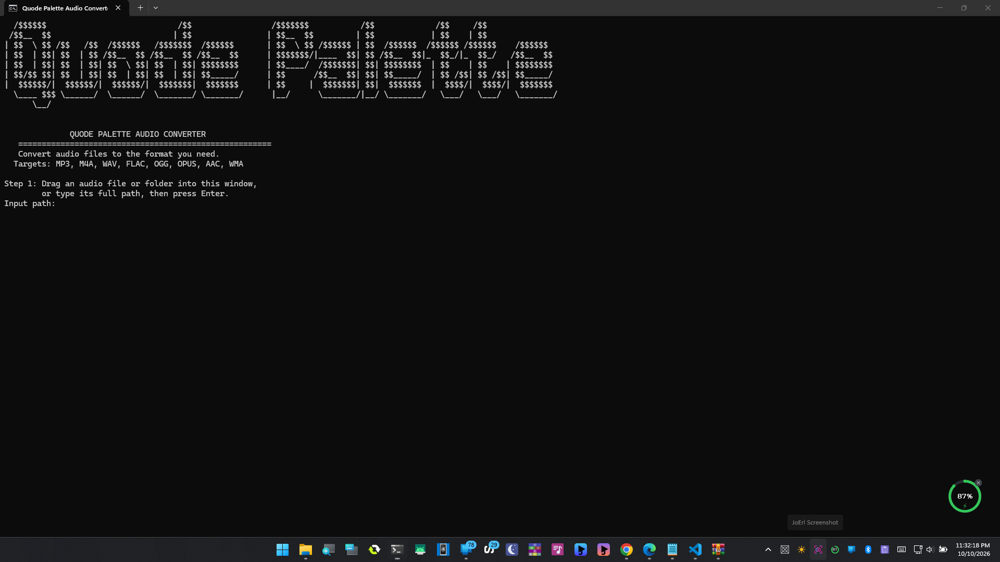
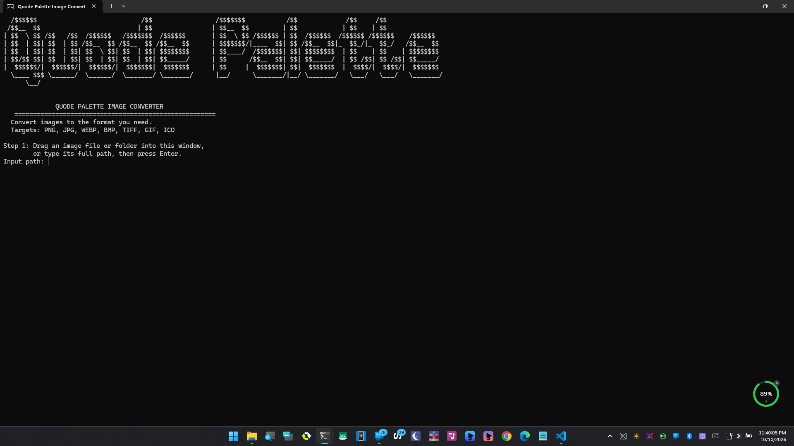
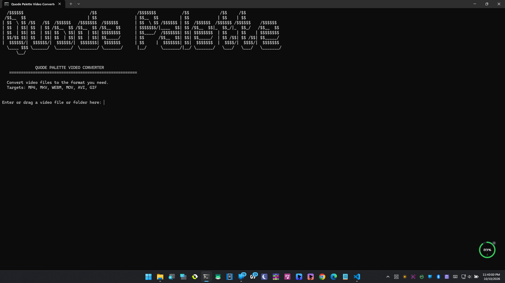

# Quode Palette Converters

A small collection of command-line media converters with Windows `.bat` launchers. Each project has its own source code and documentation.

  

  

  

## Projects

- `Quode-Palette-Audio-Converter`: convert common audio formats with FFmpeg.
- `Quode-Palette-Image-Converter`: convert common image formats with Pillow.
- `Quode-Palette-Video-Converter`: convert common video formats with FFmpeg.

## Getting started on Windows

Open the relevant project folder and double-click its `.bat` launcher. All tools require Python. The audio and video tools need FFmpeg. The release zip includes it in the shared `ffmpeg/bin` folder (keep the folder structure intact). If you cloned the repository instead, FFmpeg is not included because of GitHub's file size limit; the audio and video launchers will offer to download it automatically the first time you run them (about 200 MB, one time). The image tool uses Pillow, not FFmpeg, and installs Pillow automatically if needed.

The bundled FFmpeg is a Windows 64-bit GPL build from https://github.com/BtbN/FFmpeg-Builds; see `ffmpeg/LICENSE.txt`.

Each project README contains its own usage and requirements.

## License

Released under the [PolyForm Noncommercial License 1.0.0](LICENSE). You are free to use, modify and share it for personal, educational and other noncommercial purposes. For commercial use, please get in touch.
[Email Us](mailto:hello@quodepalette.com)

